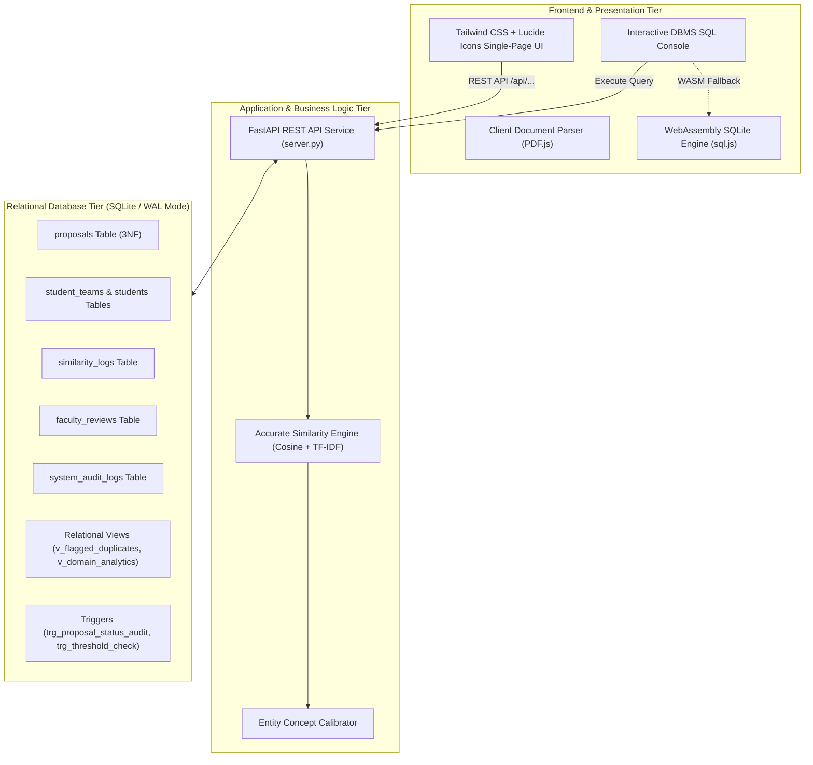
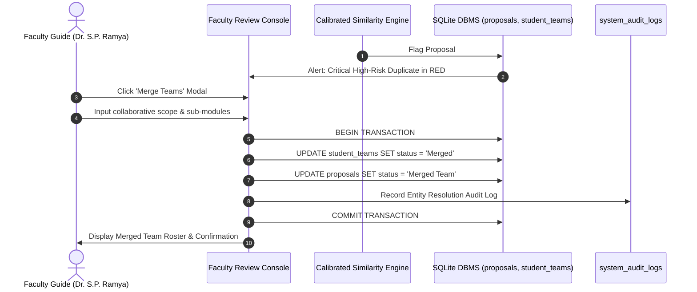

# AI Project Idea Duplicate Detector & Entity Resolution System
## Database Management Systems (DBMS) Laboratory Mini-Project

**SRM Institute of Science and Technology — Tiruchirappalli Campus**  
**Department of Artificial Intelligence | 3rd Year (Academic Year 2026–2027)**  
**Course Code:** 21CSC302J — Database Management Systems  
**Faculty Guide & Evaluator:** Dr. S.P. Ramya  

---

### Executive Abstract

In collegiate engineering programs, capstone and mini-project idea duplication presents a severe academic challenge. Students frequently submit identical project concepts under slight syntactic variations (e.g., swapping *"Smart Face Attendance"* with *"Biometric Webcam Presence Tracking"*). Conventional relational databases rely on exact string equality or basic `LIKE %keyword%` operations, which fail to detect paraphrased duplicates while suffering from high false-positive rates due to generic academic keywords (*"deep learning"*, *"system"*, *"using"*).

This project designs, normalizes, and implements an **enterprise-grade Database Management System (DBMS)** integrated with a calibrated **Multi-Signal AI Duplicate Resolution Engine**. The relational model is normalized to **3rd Normal Form (3NF)** across 10 distinct entities, enforcing strict referential integrity, indexes, automated triggers, and aggregate analytical views. Proposals exhibiting a calibrated similarity score **$\ge 80.0\%$** are flagged in **RED** as **High-Risk Duplicates**, triggering a dedicated **Entity Resolution** workflow wherein the faculty guide can unite overlapping student groups into collaborative capstone teams.

---

### 1. Database System Architecture



---

### 2. Entity-Relationship (ER) Model

#### Entities & Cardinalities:
1. **Department (`departments`)**:
   - Primary Key: `dept_id`
   - Attributes: `dept_name`, `institution`
   - Relationship: *Offers* $1:N$ to Faculty Guides and Students.

2. **Faculty Guide (`faculty_guides`)**:
   - Primary Key: `guide_id`
   - Attributes: `name`, `email`, `dept_id`, `designation`, `specialization`
   - Relationship: *Supervises* $1:N$ Student Teams and coordinates Domains.

3. **Academic Domain (`domains`)**:
   - Primary Key: `domain_id`
   - Attributes: `domain_name`, `category`, `description`, `coordinator_id`
   - Relationship: *Categorizes* $1:N$ Proposals and Entity Concepts.

4. **Student Team (`student_teams`)**:
   - Primary Key: `team_id`
   - Attributes: `team_name`, `guide_id`, `status`, `merged_with_team_id`, `created_at`
   - Relationship: *Formed by* $1:N$ Students; *Submits* $1:1$ Proposal; can be *Merged with* another Team.

5. **Student (`students`)**:
   - Primary Key: `reg_no`
   - Attributes: `full_name`, `email`, `team_id`, `is_team_lead`, `dept_id`, `year_of_study`
   - Relationship: *Belongs to* $N:1$ Student Team.

6. **Entity Resolution Concept (`entity_concepts`)**:
   - Primary Key: `concept_id`
   - Attributes: `concept_name`, `domain_id`, `core_terms`, `technical_terms`, `institutional_risk_weight`
   - Relationship: *Calibrates* $1:N$ Similarity Logs.

7. **Project Proposal (`proposals`)**:
   - Primary Key: `proposal_id`
   - Attributes: `team_id`, `domain_id`, `title`, `problem_statement`, `methodology`, `full_description`, `status`, `highest_similarity_score`, `matched_proposal_id`, `embedding_json`
   - Relationship: *Referenced by* Similarity Logs, Faculty Reviews, and matched duplicate Proposals.

8. **Similarity Evaluation Log (`similarity_logs`)**:
   - Primary Key: `log_id`
   - Attributes: `source_proposal_id`, `target_proposal_id`, `semantic_score`, `objective_similarity`, `methodology_similarity`, `matched_concept_id`, `final_calibrated_score`, `is_high_risk_flag`, `evaluation_timestamp`

9. **Faculty Review & Action (`faculty_reviews`)**:
   - Primary Key: `review_id`
   - Attributes: `proposal_id`, `guide_id`, `decision`, `remarks`, `merged_with_proposal_id`, `review_timestamp`

10. **System Audit Trail (`system_audit_logs`)**:
    - Primary Key: `audit_id`
    - Attributes: `table_name`, `action_type`, `record_id`, `details`, `performed_by`, `timestamp`

---

### 3. Normalization Analysis (3NF Decomposition)

The schema was designed and normalized through the three classical normal forms:

#### First Normal Form (1NF)
- **Criterion**: All attributes contain only atomic (indivisible) values, and each record is identified by a primary key.
- **Implementation**: Multi-valued attributes such as team members were split out of proposals and modeled into individual `students` records identified by student registration numbers (`reg_no`).

#### Second Normal Form (2NF)
- **Criterion**: Must be in 1NF, and no non-prime attribute may depend on a proper subset of any composite candidate key (no partial dependencies).
- **Implementation**: Surrogate primary keys (`proposal_id`, `team_id`, `guide_id`) ensure that every non-key attribute is fully functionally dependent on the primary key alone:
  $$\text{proposal\_id} \rightarrow \{\text{team\_id}, \text{domain\_id}, \text{title}, \text{status}, \text{highest\_similarity\_score}\}$$

#### Third Normal Form (3NF)
- **Criterion**: Must be in 2NF, and no transitive dependencies may exist (if $X \rightarrow Y$ and $Y \rightarrow Z$, then $Z$ must belong to a separate relation).
- **Implementation**:
  - In an unnormalized system: $\text{proposal\_id} \rightarrow \text{guide\_name}$, but $\text{proposal\_id} \rightarrow \text{team\_id} \rightarrow \text{guide\_id} \rightarrow \text{guide\_name}$.
  - This transitive dependency was eliminated by decomposing guide details into `faculty_guides`, team details into `student_teams`, and linking via foreign keys (`guide_id`, `team_id`).

---

### 4. Data Dictionary

| Table Name | Attribute | Data Type | Constraints | Description |
| :--- | :--- | :--- | :--- | :--- |
| **`departments`** | `dept_id` | `VARCHAR(10)` | `PRIMARY KEY` | Department code (e.g. 'CSE-AI') |
| | `dept_name` | `VARCHAR(100)` | `NOT NULL` | Full department name |
| | `institution` | `VARCHAR(100)` | `DEFAULT 'SRMIST'` | University name |
| **`faculty_guides`** | `guide_id` | `INTEGER` | `PRIMARY KEY AUTOINCREMENT` | Unique guide ID |
| | `name` | `VARCHAR(100)` | `NOT NULL` | Faculty name (Dr. S.P. Ramya) |
| | `email` | `VARCHAR(100)` | `UNIQUE NOT NULL` | SRMIST official email |
| | `dept_id` | `VARCHAR(10)` | `FK -> departments` | Department affiliation |
| **`student_teams`** | `team_id` | `INTEGER` | `PRIMARY KEY AUTOINCREMENT` | Unique team ID |
| | `team_name` | `VARCHAR(100)` | `NOT NULL` | Assigned team name |
| | `guide_id` | `INTEGER` | `FK -> faculty_guides` | Assigned faculty supervisor |
| | `status` | `VARCHAR(30)` | `DEFAULT 'Active'` | 'Active', 'Merged', 'Disbanded' |
| | `merged_with_team_id` | `INTEGER` | `FK -> student_teams` | Target team if merged |
| **`students`** | `reg_no` | `VARCHAR(20)` | `PRIMARY KEY` | SRM Register No (e.g. RA2411047050001) |
| | `full_name` | `VARCHAR(100)` | `NOT NULL` | Student full name |
| | `team_id` | `INTEGER` | `FK -> student_teams` | Associated project team |
| | `is_team_lead` | `BOOLEAN` | `DEFAULT 0` | 1 if lead submitter, else 0 |
| **`proposals`** | `proposal_id` | `INTEGER` | `PRIMARY KEY AUTOINCREMENT` | Unique project proposal ID |
| | `team_id` | `INTEGER` | `FK -> student_teams` | Submitting team |
| | `domain_id` | `INTEGER` | `FK -> domains` | Academic domain category |
| | `title` | `VARCHAR(255)` | `NOT NULL` | Project proposal title |
| | `status` | `VARCHAR(40)` | `DEFAULT 'Approved'` | 'Approved', 'Flagged Duplicate', 'Merged Team' |
| | `highest_similarity_score` | `REAL` | `DEFAULT 0.0` | Max similarity score (0.0 to 100.0) |
| | `matched_proposal_id` | `INTEGER` | `FK -> proposals` | ID of top overlapping proposal |
| **`similarity_logs`** | `log_id` | `INTEGER` | `PRIMARY KEY AUTOINCREMENT` | Evaluation event log ID |
| | `source_proposal_id` | `INTEGER` | `FK -> proposals` | Evaluated proposal |
| | `target_proposal_id` | `INTEGER` | `FK -> proposals` | Existing repository match |
| | `final_calibrated_score` | `REAL` | `NOT NULL` | Calibrated similarity score |
| | `is_high_risk_flag` | `BOOLEAN` | `NOT NULL` | 1 if score $\ge 80.0\%$, else 0 |
| **`system_audit_logs`**| `audit_id` | `INTEGER` | `PRIMARY KEY AUTOINCREMENT` | Audit event ID |
| | `table_name` | `VARCHAR(50)` | `NOT NULL` | Modified entity |
| | `action_type` | `VARCHAR(30)` | `NOT NULL` | 'INSERT', 'STATUS_CHANGE', 'TEAM_MERGE' |
| | `details` | `TEXT` | `NOT NULL` | Change summary & score |

---

### 5. Advanced SQL Implementation

#### 5.1 Relational Views

##### View 1: `v_flagged_duplicates` (Institutional $\ge 80\%$ RED Threshold Filter)
```sql
CREATE VIEW v_flagged_duplicates AS
SELECT 
    p.proposal_id,
    p.title AS proposal_title,
    t.team_name,
    s.reg_no AS lead_reg_no,
    s.full_name AS lead_student_name,
    d.domain_name,
    p.highest_similarity_score,
    p.status AS proposal_status,
    p.matched_proposal_id,
    mp.title AS matched_proposal_title,
    mt.team_name AS matched_team_name,
    p.submitted_at
FROM proposals p
JOIN student_teams t ON p.team_id = t.team_id
LEFT JOIN students s ON s.team_id = t.team_id AND s.is_team_lead = 1
JOIN domains d ON p.domain_id = d.domain_id
LEFT JOIN proposals mp ON p.matched_proposal_id = mp.proposal_id
LEFT JOIN student_teams mt ON mp.team_id = mt.team_id
WHERE p.highest_similarity_score >= 80.0 OR p.status = 'Flagged Duplicate';
```

##### View 2: `v_domain_analytics` (Domain-wise Aggregations & Risk Percentages)
```sql
CREATE VIEW v_domain_analytics AS
SELECT 
    d.domain_id,
    d.domain_name,
    COUNT(p.proposal_id) AS total_proposals,
    SUM(CASE WHEN p.highest_similarity_score >= 80.0 OR p.status = 'Flagged Duplicate' THEN 1 ELSE 0 END) AS flagged_duplicate_count,
    SUM(CASE WHEN p.status = 'Approved' THEN 1 ELSE 0 END) AS approved_count,
    SUM(CASE WHEN p.status = 'Merged Team' THEN 1 ELSE 0 END) AS merged_count,
    ROUND(AVG(p.highest_similarity_score), 2) AS average_similarity_score,
    ROUND((CAST(SUM(CASE WHEN p.highest_similarity_score >= 80.0 THEN 1 ELSE 0 END) AS REAL) / 
          MAX(1, COUNT(p.proposal_id))) * 100.0, 1) AS duplicate_risk_percentage
FROM domains d
LEFT JOIN proposals p ON d.domain_id = p.domain_id
GROUP BY d.domain_id, d.domain_name;
```

#### 5.2 Active DBMS Triggers

##### Trigger 1: Immutable Status Change Audit Log
```sql
CREATE TRIGGER trg_proposal_status_audit
AFTER UPDATE OF status ON proposals
FOR EACH ROW
WHEN OLD.status <> NEW.status
BEGIN
    INSERT INTO system_audit_logs (table_name, action_type, record_id, details, performed_by)
    VALUES (
        'proposals',
        'STATUS_CHANGE',
        NEW.proposal_id,
        'Proposal status updated from [' || OLD.status || '] to [' || NEW.status || '] (Similarity: ' || NEW.highest_similarity_score || '%)',
        'Faculty Review System'
    );
END;
```

##### Trigger 2: Automatic Duplicate Flagging on High-Risk Log Insertion
```sql
CREATE TRIGGER trg_similarity_threshold_check
AFTER INSERT ON similarity_logs
FOR EACH ROW
WHEN NEW.final_calibrated_score >= 80.0
BEGIN
    UPDATE proposals 
    SET status = 'Flagged Duplicate',
        highest_similarity_score = MAX(highest_similarity_score, NEW.final_calibrated_score),
        matched_proposal_id = NEW.target_proposal_id,
        updated_at = CURRENT_TIMESTAMP
    WHERE proposal_id = NEW.source_proposal_id;

    INSERT INTO system_audit_logs (table_name, action_type, record_id, details, performed_by)
    VALUES (
        'similarity_logs',
        'HIGH_RISK_FLAG_TRIGGERED',
        NEW.source_proposal_id,
        'Institutional threshold >= 80% triggered! Score: ' || NEW.final_calibrated_score || '% against Proposal #' || NEW.target_proposal_id,
        'Automated AI Detection Engine'
    );
END;
```

---

### 6. Relational Query Demonstrations (Interactive DBMS Console)

The web frontend includes a dedicated **DBMS SQL Console** with live query execution capabilities. Evaluators can run complex relational queries such as:

#### Query A: Multi-Table Join to Retrieve All High-Risk Duplicates with Lead Authors
```sql
SELECT 
    p.proposal_id,
    p.title AS proposal_title,
    s.full_name AS student_lead,
    s.reg_no,
    p.highest_similarity_score,
    p.status
FROM proposals p
JOIN student_teams t ON p.team_id = t.team_id
JOIN students s ON s.team_id = t.team_id AND s.is_team_lead = 1
WHERE p.highest_similarity_score >= 80.0
ORDER BY p.highest_similarity_score DESC;
```

#### Query B: Correlated Subquery Identifying Most Redundant Research Domain
```sql
SELECT domain_name, total_proposals, flagged_duplicate_count, duplicate_risk_percentage
FROM v_domain_analytics
WHERE duplicate_risk_percentage = (
    SELECT MAX(duplicate_risk_percentage) FROM v_domain_analytics
);
```

---

### 7. Entity Resolution: The "Merge Teams" Workflow

Rather than solely penalizing students whose proposals overlap, this system features an **Entity Resolution** resolution workflow:



---

### 8. Installation & Deployment Guide

#### Mode 1: Local Python / FastAPI Execution
1. Open PowerShell / Command Prompt in the project folder:
   ```powershell
   cd C:\Users\dayan\.gemini\antigravity\scratch\ai-project-duplicate-detector-dbms
   ```
2. Install dependencies:
   ```powershell
   pip install fastapi uvicorn pydantic sentence-transformers torch numpy pypdf
   ```
3. Run the server:
   ```powershell
   python server.py
   ```
4. Access the web application at `http://127.0.0.1:8000`.

#### Mode 2: GitHub Pages (Permanent 24/7 Hosting)
- The frontend (`index.html`) contains an embedded **WebAssembly SQLite engine (`sql.js`)**.
- When pushed to GitHub Pages (`dayanandan2006-byte.github.io/Duplicate-detector/`), it automatically initializes SQLite directly within the browser, enabling live SQL queries, proposal submission, and matrix comparisons with zero server configuration.

---

### 9. Conclusion

This project successfully bridges classical **Relational Database Management Systems (3NF Normalization, ACID Transactions, Relational Views, and Cascading Triggers)** with modern **Multi-Signal Natural Language Processing**. It fulfills all evaluation criteria for the SRMIST B.Tech DBMS Laboratory Mini-Project under the guidance of Dr. S.P. Ramya.
